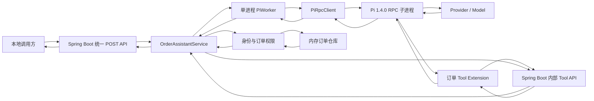
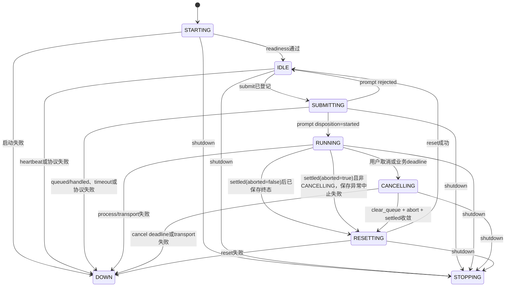

# Spring Boot + Pi 订单查询助手技术方案（实施基线）

> 研究日期：2026-10-22
> 修订目标：实现一个有完整学习价值、但不按生产平台复杂度建设的 Spring Boot + Pi RPC Demo。
> 当前状态：技术方案已完成结构化修订；尚未编码、运行测试或调用真实 Provider。
> 适用版本：Pi `1.4.0`。实现必须继续使用精确版本和 lockfile，不使用浮动 `latest`。
> 本文是实施依据，不代表代码、测试、真实 Provider 或运行结果已经完成。

## 0. 文档状态与证据边界

本文使用三类表述：

- **Pi 合同事实**：由本机 Pi `1.4.0` 的固定发布包、官方文档或 `v1.4.0` 源码核对。实现仍需用启动探针和测试确认当前依赖树没有改变行为。
- **项目设计决定**：为了教学 Demo 明确选择的行为，例如只允许一个活动任务、失败任务使用 `FAILED + errorCode`、取消使用 `clear_queue + abort`。
- **实现前验证项**：当前没有运行证据，必须在对应阶段通过单元测试、集成测试或真实 Pi + Fake Provider E2E 取得直接证据。

本文已经完成设计修订，但以下事实仍未发生：

- 没有创建 Spring Boot 项目代码；
- 没有创建 Pi Extension；
- 没有安装或验证本项目自己的 Maven/npm lockfile；
- 没有启动本项目的真实 Pi 垂直链路；
- 没有运行 Java、Extension 或 E2E 测试；
- 没有调用真实 Provider；
- 没有把本方案标记为学习计划中的完成项。

文档中“必须验证”不能被“设计中已经写明”替代。唯一进度台账仍是 `docs/plans/pi-complete-learning-plan.md`，本次文档修订不改变其完成状态。

## 1. 项目定位、目标与范围

### 1.1 项目定位

本项目是一个教学型、可运行的 Spring Boot + Pi RPC Demo。它展示 Java 与 Pi 的主要集成边界，并控制并发、安全和构建复杂度。

它不是：

- 一次性的 Hello World；
- 生产级 Agent 平台；
- 真实订单系统；
- 多租户任务平台；
- 有持久化、队列、自动恢复和水平扩容能力的服务。

### 1.2 必须学到的内容

1. Java 使用 `ProcessBuilder` 启动和管理长驻 Pi 子进程。
2. Java 通过 stdin/stdout 使用 Pi RPC 的 LF JSONL 协议。
3. 区分 Command Response、流式 Event 和最终 `agent_settled`。
4. 理解 `prompt` Response 的 `disposition` 与 `agent_settled.aborted`。
5. 使用 Pi Extension 注册三个自定义业务 Tool。
6. Extension 通过 loopback HTTP 调用 Spring Boot 业务能力。
7. Java 管理单活动 Agent 任务、状态查询、取消和超时。
8. 使用 `new_session` 清理跨任务的内存上下文。
9. 使用真实 Pi + Fake Provider 完成确定性端到端测试。
10. 理解 Demo 身份、进程 Token、Provider 可见数据和真实 Provider 的安全边界。

### 1.3 首版不实现的内容

- 多 Pi 进程、并行 Prompt、任务排队和水平扩容；
- 通用 Tool 平台、MCP Server、动态 Tool 注册 API 或任意 Java 方法调用；
- 跨容器 CAS、Producer Lease 或自定义 WriterMailbox 状态机；
- 自动重启 Pi、断点恢复和持久化任务；
- 生产认证、真实订单系统、数据库、消息队列和写操作；
- 真实 Provider 的费用、网络出口和回答语义保证；
- 方法级测试清单、测试报告哈希、防命令行篡改矩阵等对抗式门禁；
- 自动读取、解析或哈希真实认证文件的预检器。

### 1.4 复杂度原则

- 一个 `PiWorker` 的运行时可变状态只由一个 coordinator 线程修改。
- 只为当前学习目标增加组件，不提前建设平台层。
- 每个状态、线程、字段和测试都必须对应明确的学习目标或安全边界。
- 第一个真实 Pi 垂直链路必须在完成基础 runtime 后尽早实现。
- `pi.runtime` 不依赖订单、Web 或安全包；订单语义通过 run-scoped tracker 组合进 Worker。
- 失败任务只要 Pi Session 仍然可信，也必须 reset；只有传输层或进程不可信时才跳过 reset 并进入 `DOWN`。

## 2. 总体架构与所有权

### 2.1 系统架构

Java 管理一个长驻 Pi RPC 子进程。Pi Extension 固定注册 `query_order`、`query_payment`、`query_logistics` 三个只读 Tool，并通过 loopback HTTP 回调同一个 Spring Boot 进程。



一次健康任务的主流程是：

1. 调用方提交问题，Java 校验 Demo userId、orderId 和 question。
2. `OrderAssistantService` 创建 `taskId`、`runId`、可信 actor/resource 绑定和 `OrderRunTracker`。
3. `PiWorker` 在 `IDLE` 状态登记 Prompt Pending Command，发送 Prompt，并等待 `disposition="started"`。
4. 只有 Prompt Response 明确表示 `started` 后，Worker 才发布可查询的任务快照。
5. Pi 产生 Agent、Message 和 Tool Event；Extension 调用内部 Bridge。
6. Bridge 通过 loopback、进程 Token、当前 Run reservation 和订单权限完成只读查询。
7. Tracker 按协议和订单合同验证 Tool Call、Tool Result、最终 Assistant Message 与 `agent_settled`。
8. Java 保存任务终态，使用 `new_session` 清理 Pi 内存上下文，再重新验证 readiness。

### 2.2 所有权划分

| 能力 | Java/Spring Boot | Pi/Extension |
|---|---|---|
| Demo 身份与可信 principal | 拥有 | 不可伪造或决定 |
| tenant、owner、support 规则 | 拥有 | 不可决定 |
| 订单聚合和白名单投影 | 拥有 | 只能通过 Tool 读取 |
| Agent Loop 和 Provider 适配 | 不拥有 | 拥有 |
| Tool Schema 与 Tool 执行生命周期 | 通过 AgentDefinition 约束 | Extension 注册并执行 |
| Prompt 接受、Event、settled | Worker 观察和判定 | Pi 产生 |
| 任务状态和取消顺序 | Worker 拥有 | 不拥有 |
| Session reset | Worker 发送和验证 | Pi 执行 |
| Provider 凭据 | 只通过受控启动环境提供 | Pi/Provider 使用 |

Provider 会看到用户问题、订单号、`runId`、三个 Tool Schema 和被调用 Tool 的有界结果。Provider 不会看到 Bridge 进程 Token、可信 principal 或 tenant 权限对象。

### 2.3 包依赖方向

保持单 Maven Module，通过包和 ArchUnit 约束边界：

```text
web
  -> order.application
      -> agent
          -> pi.runtime
      -> order.domain
      -> order.security
```

具体要求：

- `pi.runtime` 只处理 Pi 协议和进程，不依赖 agent/order/web/security。
- `agent` 组合 runtime 并定义 Worker/Run 合同，不依赖 order/web。
- `order.application` 创建 `OrderRunTracker`、调用 PiWorker，并连接订单领域与统一 API。
- `web` 不直接调用 `PiRpcClient` 或 `PiProcessManager`。
- 首版不实现动态 Agent Registry、插件加载、反射或 ServiceLoader。
- 出现第二种 Agent 后再评估是否提取独立 runtime Module。

## 3. 固定版本与启动环境

### 3.1 版本基线

| 组件 | 版本 | 锁定方式 |
|---|---:|---|
| JDK | 21 | `.java-version` + Maven Enforcer 主版本检查 |
| Spring Boot | `4.1.1` | `pom.xml` Parent/BOM 精确版本 |
| Maven | `3.9.16` | Maven Wrapper + distribution checksum |
| Node.js | `24.20.0` | `.node-version`，启动和构建前校验绝对路径与版本 |
| npm | `11.19.0` | 同一 Node Home 下的 npm CLI + `packageManager` |
| Pi | `1.4.0` | `package.json` 与 lockfile 精确依赖 |
| TypeScript | `5.9.3` | 精确 devDependency |
| TypeBox | `1.3.27` | 精确 dependency |
| undici | `8.10.2` | 精确 dependency |
| ArchUnit | `1.4.2` | test scope |

Pi `1.4.0` 的 Node engine 要求为 `>=22.19.0`。本方案固定 Node `24.20.0`，避免使用浮动版本。所有 `@earendil-works/pi-*` 内部包必须统一为 `1.4.0`，由 `package-lock.json` 固定完整依赖树。

Pi CLI 包的 canonical entrypoint 由安装包 `bin` 字段确定，当前 `1.4.0` 包为：

```text
<project>/pi-extension/node_modules/@earendil-works/pi-coding-agent/dist/bundle/cli.js
```

实现不得把当前机器的个人绝对路径写入项目合同。路径由项目根目录和安装后的受控依赖目录拼接，并在启动前校验 realpath。

### 3.2 官方合同参考

实现以固定版本资料为准，不能只依赖 `/latest` 页面：

- [Pi RPC 文档（v1.4.0）](https://github.com/earendil-works/pi/blob/v1.4.0/packages/coding-agent/docs/rpc.md)
- [Pi Extension 文档（v1.4.0）](https://github.com/earendil-works/pi/blob/v1.4.0/packages/coding-agent/docs/extensions.md)
- [Pi SDK 文档（v1.4.0）](https://github.com/earendil-works/pi/blob/v1.4.0/packages/coding-agent/docs/sdk.md)
- [RPC 命令参考（v1.4.0）](https://github.com/earendil-works/pi/blob/v1.4.0/packages/coding-agent/docs/rpc-commands.md)
- [JSON Event Stream（v1.4.0）](https://github.com/earendil-works/pi/blob/v1.4.0/packages/coding-agent/docs/json.md)
- [RPC 类型](https://github.com/earendil-works/pi/blob/v1.4.0/packages/coding-agent/src/modes/rpc/rpc-types.ts)
- [Extension 类型](https://github.com/earendil-works/pi/blob/v1.4.0/packages/coding-agent/src/core/extensions/types.ts)
- [消息类型](https://github.com/earendil-works/pi/blob/v1.4.0/packages/coding-agent/docs/message-types.md)
- [Pi 1.4.0 Release](https://github.com/earendil-works/pi/releases/tag/v1.4.0)

### 3.3 工作目录、配置和信任边界

- Spring Boot 绑定 `127.0.0.1`。
- `ProcessBuilder.directory()` 固定为受控项目根目录。
- Pi 使用专用 `PI_CODING_AGENT_DIR`，测试使用独立临时 AgentDir。
- 启动命令明确关闭自动发现的 Extension、MCP、Context Files、Skills、Prompt Templates 和 Themes。
- 只加载 canonical 订单 Extension。
- `--approve` 只有在项目根目录和 `.pi/settings.json` 都是受控、可审查来源时才允许使用；不得把任意用户目录作为工作目录启动。由于 `--offline` 不会阻止后续 Provider 请求，Fake Provider 仍可使用 loopback；E2E 必须直接验证该行为。
- 预检器检查项目配置文件和 Extension 路径，但不读取、解析、打印或哈希真实认证内容。
- 真正需要抵抗同一 OS 用户、root、任意子进程或公网攻击时，必须使用操作系统用户隔离、容器、虚拟机或网络沙箱；本方案不提供这些能力。

### 3.4 子进程环境白名单

环境从空白 Map 构建，只保留：

- `HOME`、`TMPDIR`、必要 locale；
- `PI_CODING_AGENT_DIR`；
- Bridge host、port 和一次性进程 Token；
- 明确指定的 Fake Provider 或真实 Provider 变量；
- Node 运行所需的最小平台变量。

不得继承：

- 任意代理变量；
- 云身份和未批准的 Key/Token；
- `NODE_OPTIONS`；
- 未批准的 Provider 配置；
- 任意父进程环境。

绝对 Node 路径、Pi CLI 路径、Extension 路径和工作目录都不依赖 Shell PATH。环境隔离不是操作系统沙箱，Token 仍可能被同一 OS 用户读取。

## 4. 订单领域与 Demo 身份

### 4.1 固定身份

| userId | tenant | 权限 |
|---|---|---|
| `alice` | `tenant-a` | 读取自己的订单 |
| `bob` | `tenant-b` | 读取自己的订单 |

`DemoIdentityService` 根据请求中的固定 `userId` 创建 canonical principal。客户端不能提交 tenant、角色或权限对象。当前版本只实现 owner 规则；support 角色不在首版范围内。

### 4.2 固定订单

| tenant | orderId | order | payment | logistics |
|---|---|---|---|---|
| `tenant-a` | `12345` | `PAID` | `SUCCEEDED` | `NOT_CREATED` |
| `tenant-b` | `67890` | `SHIPPED` | `SUCCEEDED` | `IN_TRANSIT` |

领域保持一个订单聚合，不模拟三个微服务。`Order` 内包含订单主状态、支付快照和物流快照，三个 Tool 只是同一授权聚合的不同白名单投影。

如果实现需要更强地证明 tenant predicate，可以在测试夹具中让两个 tenant 使用相同的 orderId，并使用 `(tenant, orderId)` 作为仓库键；这不改变公开 Demo 数据的最小规模。

### 4.3 领域规则

- `OrderAccessService` 是唯一执行订单读取权限、tenant 和 owner 规则的组件。
- 订单不存在和无权限统一映射为 `ORDER_NOT_ACCESSIBLE`。
- 支付投影不返回金额、卡号或用户信息。
- 物流投影不返回地址、电话或收件人信息。
- Model 传入的 orderId 必须等于当前任务的可信 `resourceId`。
- 订单日期时间统一使用 UTC ISO-8601 格式；具体 DTO 字段在 API 合同中固定。
- 领域聚合和快照使用不可变对象。

## 5. 通用 HTTP 合同

### 5.1 请求包络

所有公共业务 API 和内部 Tool API 使用：

```json
{
  "requestId": "11111111-1111-4111-8111-111111111111",
  "data": {}
}
```

Java 类型为 `ApiRequest<T>`。

约束：

- `requestId` 必须是小写 canonical UUIDv4；不能只依赖宽松的 `UUID.fromString`。
- `requestId` 只关联一次 HTTP 调用，不承担任务标识、去重或幂等语义。
- `data` 必须非空，并使用 `@Valid` 递归校验。
- JSON 必须为单个 object；数组、字符串、数字、`null` 均拒绝。
- `Content-Type` 必须是 `application/json`，允许明确的 UTF-8 charset。
- 公共业务 request body 上限统一为 8 KiB，内部 Bridge 的 HTTP request body 上限统一为 1 KiB；两者都必须在读取过程中按实际 UTF-8 字节数限制，不能只依赖 `Content-Length`。
- 公共和内部请求都拒绝未知 JSON properties；外层包络和 `data` DTO 都按 `additionalProperties=false` 的合同校验。
- 公共业务响应 body 上限统一为 16 KiB，以容纳最多 8 KiB 的 UTF-8 Answer 和响应包络；内部 Bridge 响应 body 上限统一为 2 KiB；Extension 将最终 Tool Result 限制为 2 KiB。
- 只依赖 `Content-Length` 不足以完成限流，chunked body 也必须在读取过程中限制。

### 5.2 响应包络

所有成功和失败响应都使用：

```json
{
  "requestId": "11111111-1111-4111-8111-111111111111",
  "success": true,
  "code": "OK",
  "message": "success",
  "data": {}
}
```

约束：

- `requestId` 原样回显；如果 JSON 在解析 requestId 前已经损坏，允许为 `null`。
- `success` 只表示本次 HTTP API 是否完成，不代表 Agent 任务最终成功。
- `code` 是固定、有界的机器码。
- `message` 是固定安全文本，不包含异常正文、订单数据、Token 或 Provider 错误正文。
- `data` 成功时为具体 DTO，失败时为 `null`。
- status API 查到一个失败任务时，HTTP 仍返回 200 且 `success=true`；任务结果由 `data.status/errorCode` 表达。

### 5.3 标识符语义

| 标识符 | 生命周期 | 用途 | 是否 secret |
|---|---|---|---|
| `requestId` | 一次 HTTP 调用 | 请求关联 | 否 |
| `taskId` | 一次已发布任务 | status/cancel 查询 | 否 |
| `runId` | 一次 Agent Run | Prompt、Tool 和 Tracker 关联 | 否 |
| Process Token | 一个 Pi 子进程 | Bridge 调用方隔离 | 是 |
| `sessionId` | 一个 Pi Session | reset 前后上下文识别 | 否 |
| `processGeneration` | 一个 Pi 进程生命周期 | 丢弃旧 transport Event | 内部字段 |
| `sessionGeneration` | 一个 Pi Session 生命周期 | 丢弃旧 Session Event | 内部字段 |

### 5.4 业务端点

| 功能 | Method | Path |
|---|---|---|
| 提交订单助手任务 | POST | `/api/v1/order-assistant/queries/submit` |
| 查询任务状态和结果 | POST | `/api/v1/order-assistant/queries/status` |
| 取消任务 | POST | `/api/v1/order-assistant/queries/cancel` |
| 查询订单主状态 Tool | POST | `/internal/v1/agent-tools/query-order` |
| 查询支付状态 Tool | POST | `/internal/v1/agent-tools/query-payment` |
| 查询物流状态 Tool | POST | `/internal/v1/agent-tools/query-logistics` |

业务接口全部使用 POST。Actuator Health 保留 Spring Boot 默认 GET 语义。

### 5.5 提交任务

请求：

```json
{
  "requestId": "11111111-1111-4111-8111-111111111111",
  "data": {
    "userId": "alice",
    "orderId": "12345",
    "question": "这个订单现在怎么样？"
  }
}
```

约束：

- `userId` 只允许固定 Demo 用户 `alice` 或 `bob`。
- `orderId` 匹配 `^[0-9]{1,20}$`。
- `question` 长度为 1..512 个 Unicode 字符，编码后的最终 RPC Prompt 不超过 4 KiB。
- 公共 submit/status/cancel request body 最大 8 KiB；内部 Bridge request body 最大 1 KiB；超过上限在 JSON 反序列化前拒绝。
- question 中的控制字符按 JSON 输入校验规则处理；不得把用户文字未经 JSON 编码直接拼入 Prompt。
- 客户端不能提交 tenant、角色、principal、Tool allowlist 或 capability secret。

`OrderAssistantService` 先创建 `taskId`、`runId`、`OrderRunTracker` 和 `AgentRunRequest`，再提交给 `PiWorker`。只有同时收到：

```json
{
  "success": true,
  "data": { "disposition": "started" }
}
```

才发布任务并返回 202：

```json
{
  "requestId": "11111111-1111-4111-8111-111111111111",
  "success": true,
  "code": "TASK_ACCEPTED",
  "message": "task accepted",
  "data": {
    "taskId": "22222222-2222-4222-8222-222222222222",
    "status": "RUNNING"
  }
}
```

`queued` 和 `handled` 都不符合本项目单活动 Run 合同：

- `queued` 表示 Prompt 被排队，不能发布当前 taskId；
- `handled` 可能表示 Extension Command 消费了 Prompt，不能把它当成 Agent Run；
- 两种情况都按协议错误处理，关闭 Pi 并返回 503 `PROMPT_DISPOSITION_INVALID`。

Prompt 被明确拒绝时返回 503 `PROMPT_REJECTED`。2 秒内没有收到 `success=true + disposition=started` 时关闭 Pi 并返回 503 `RPC_TIMEOUT`。这些情况不返回可查询 taskId，但调用方不得因此假定 Provider 一定没有收到请求。

### 5.6 查询任务

请求：

```json
{
  "requestId": "33333333-3333-4333-8333-333333333333",
  "data": {
    "userId": "alice",
    "taskId": "22222222-2222-4222-8222-222222222222"
  }
}
```

TaskStatus 固定为：

- `RUNNING`
- `CANCELLING`
- `COMPLETED`
- `FAILED`
- `CANCELLED`
- `PROCESS_EXITED`

成功完成示例：

```json
{
  "requestId": "33333333-3333-4333-8333-333333333333",
  "success": true,
  "code": "OK",
  "message": "success",
  "data": {
    "taskId": "22222222-2222-4222-8222-222222222222",
    "status": "COMPLETED",
    "usedTools": ["query_order", "query_payment", "query_logistics"],
    "answer": "订单已支付，暂未创建物流信息。",
    "errorCode": null
  }
}
```

只有 `COMPLETED` 返回 `answer`。其他终态只返回固定 `errorCode`；失败任务可以返回已经安全记录的 `usedTools`，但不得返回部分 Answer。

未知 taskId、非任务所有者和 TTL 到期统一返回 404 `TASK_NOT_FOUND`，避免泄漏任务存在性。

终态保留规则：

- 终态快照保留 10 分钟；
- 最多保留 32 条终态快照；
- 超过容量时删除最早进入终态的快照；
- 活动任务不参与终态淘汰；
- TTL 判断使用注入的时钟，测试不得依赖真实睡眠；
- status 和 cancel 的读取、过期、删除顺序必须由不可变快照和 Worker 事件顺序决定。

### 5.7 取消任务

请求：

```json
{
  "requestId": "44444444-4444-4444-8444-444444444444",
  "data": {
    "userId": "alice",
    "taskId": "22222222-2222-4222-8222-222222222222"
  }
}
```

| 当前任务状态 | HTTP | code | 结果 |
|---|---:|---|---|
| `RUNNING` | 202 | `CANCEL_ACCEPTED` | 进入 `CANCELLING`，只发送一次 clear_queue 和一次 abort |
| `CANCELLING` | 202 | `CANCEL_ACCEPTED` | 幂等返回，不重复发送 |
| `CANCELLED` | 200 | `OK` | 幂等返回终态 |
| `COMPLETED/FAILED/PROCESS_EXITED` | 409 | `TASK_ALREADY_TERMINAL` | 不改写原终态 |
| 未知或非所有者 | 404 | `TASK_NOT_FOUND` | 不泄漏任务存在性 |

只有已经收到 `disposition=started` 并返回 taskId 的任务可以被取消。`SUBMITTING` 任务尚未发布，不能通过 status/cancel 查询。

### 5.8 HTTP 错误码

| HTTP | code | 场景 |
|---:|---|---|
| 400 | `VALIDATION_ERROR` | JSON、requestId 或业务字段非法 |
| 413 | `REQUEST_TOO_LARGE` | 公共请求超过 8 KiB 或内部 Bridge 请求超过 1 KiB |
| 401 | `DEMO_USER_INVALID` | Demo userId 缺失或未知 |
| 404 | `TASK_NOT_FOUND` | 任务未知、越权或已过期 |
| 409 | `TASK_ALREADY_TERMINAL` | 对终态任务取消 |
| 429 | `AGENT_BUSY` | 已有活动任务 |
| 429 | `AGENT_RESETTING` | 正在 reset |
| 503 | `AGENT_UNAVAILABLE` | Pi 未就绪、协议错误或进程不可用 |
| 503 | `PROMPT_REJECTED` | Prompt 被 Pi 在接受前拒绝 |
| 503 | `RPC_TIMEOUT` | Command Response 超时 |

内部 Tool 使用同一响应包络，但不得把 HTTP code、requestId 或 Java 异常正文交给 Model。内部固定错误码包括：

- `BRIDGE_UNAUTHORIZED`
- `RUN_NOT_ACCEPTED`
- `TOOL_NOT_ALLOWED`
- `TOOL_ALREADY_USED`
- `ORDER_ID_MISMATCH`
- `ORDER_NOT_ACCESSIBLE`
- `TOOL_TIMEOUT`
- `TOOL_RESPONSE_INVALID`

任务终态还可以使用：

- `TOOL_FAILED`
- `AGENT_RESULT_INVALID`
- `TIMEOUT`
- `PROCESS_EXITED`
- `AGENT_ABORTED_UNEXPECTED`

### 5.9 幂等和重试边界

`requestId` 不承担 submit 幂等语义。下面的情况允许发生：

```text
Pi 已接受 Prompt
Java 尚未收到 Prompt Response
Java 因 RPC_TIMEOUT 关闭 Pi
调用方收到 503
调用方重新提交同一个问题
```

第一次调用可能已经产生 Provider 请求或费用，第二次调用可能重新执行。首版只保证一个 Pi 进程内最多一个活动 Run，不保证调用方重试的 exactly-once 语义。接入有副作用 Tool 或真实业务后，必须增加幂等键、持久化提交记录或外部任务协调。

## 6. AgentDefinition、Run 和 Tracker 合同

### 6.1 固定 AgentDefinition

```java
public record AgentDefinition(
    String id,
    String systemPrompt,
    String provider,
    String model,
    Path extensionEntrypoint,
    Set<String> tools
) {}
```

构造时必须完成：

- 字符串非空和长度校验；
- Provider、Model、Agent id 使用受控配置；
- Extension path 完成 realpath 和受控目录校验；
- Tool 集合使用 `Set.copyOf`，并按稳定顺序生成命令行；
- 首版 Tool 集合必须恰好为 `query_order`、`query_payment`、`query_logistics`。

首版只创建一个 `order-assistant` 定义，不实现动态 Registry。

### 6.2 AgentRunRequest 与 AgentRunResult

```text
AgentRunRequest
  taskId
  runId
  actorId       // 当前为 Demo userId
  resourceId    // 当前为 orderId
  prompt
  tracker       // 当前为 OrderRunTracker
```

AgentRunResult 是领域无关结果：

```text
status       // COMPLETED / FAILED / CANCELLED / PROCESS_EXITED
answer       // 仅 COMPLETED 可有值，最大 8 KiB UTF-8 字节
usedTools   // 固定 Tool 名，最多三个
errorCode    // 终态失败时的固定机器码
```

`PiWorker` 不 import `Order`、`DemoPrincipal`、Controller 或订单错误码。订单规则由 `OrderRunTracker` 和 `OrderAssistantService` 组合完成。

### 6.3 AgentRunTracker

Tracker 只解释当前 Run 的 Pi Event，不启动进程、不发送 Command、不访问 TaskStore，也不负责 Tool HTTP 授权。

建议的行为合同为：

```text
onPromptStarted()
onEvent(RpcRecord) -> CONTINUE | RUN_INVALID | TRANSPORT_INVALID
result() -> Optional<AgentRunResult>
```

- `CONTINUE`：事件可以继续处理；
- `RUN_INVALID`：当前 Run 不可能满足业务成功合同，但若 transport 仍可信，继续等待 `agent_settled` 后进入失败和 reset；
- `TRANSPORT_INVALID`：记录损坏、关键字段类型错误或协议无法继续，Worker 终止 Pi 并进入 `DOWN`；
- `result()` 只有在 `agent_settled` 或明确终止后才作为终态结果读取。

如果实现保留 `void onEvent` 的 Java 接口，也必须在实现合同中定义 Tracker 异常、业务非法事件和传输非法事件分别如何传递给 Worker。

### 6.4 OrderRunTracker 成功条件

一次任务标记为 `COMPLETED` 必须同时满足：

1. Prompt Response 为 `success=true` 且 `disposition="started"`。
2. 至少调用一个、最多调用三个订单 Tool。
3. Tool 名来自固定集合，每个 Tool 最多调用一次。
4. 每个 `toolCallId` 非空且唯一。
5. 每个 Tool Call 的 `runId` 和 `orderId` 匹配当前任务。
6. 每个 Tool 出现 `tool_execution_end(isError=false)`。
7. 每个 Tool 都有同 ID 的成功 Tool Result Message。
8. 最终 Assistant Message 出现在全部 Tool Result 后。
9. 最终消息的 `stopReason=stop`，包含 1..8 KiB 的文本，且不再包含 Tool Call。
10. 在关闭 Retry、Compaction，并且不发送 steering/follow-up 的配置下，不出现未预期的后续 Agent Run。
11. 最后出现 `agent_settled` 且 `aborted=false`。

以下情况都不能标记为 `COMPLETED`：

- Tool 失败；
- 重复 Tool；
- 未知 Tool；
- 零 Tool；
- 参数不匹配；
- 最终消息缺失或超限；
- `stopReason` 不是 `stop`；
- 非取消原因下 `agent_settled.aborted=true`；
- 进程、transport 或关键协议错误。

`message_end.message` 是最终消息权威来源。不能使用 `message_update` 的增量文本替代它。

## 7. Pi 启动与 readiness 合同

### 7.1 固定启动命令

`PiWorker` 根据构造时绑定的 AgentDefinition 生成命令：

```text
<absolute-node-24.20.0>
<project>/pi-extension/node_modules/@earendil-works/pi-coding-agent/dist/bundle/cli.js
  --mode rpc
  --approve
  --offline
  --no-session
  --no-context-files
  --no-extensions
  --no-mcp
  --extension <canonical-extension-entrypoint>
  --no-skills
  --no-prompt-templates
  --no-themes
  --tools query_order,query_payment,query_logistics
  --provider <required-provider>
  --model <required-model>
  --thinking off
  --system-prompt <fixed-order-assistant-prompt>
  --order-assistant-extension
```

说明：

- `--no-extensions` 关闭自动发现、项目配置和内置 Extension，但显式 `--extension` 仍然加载。
- `--no-mcp` 显式关闭内置 MCP。
- `--tools` 使用三个固定名称的 allowlist，不依赖默认 Tool 集合。
- `--offline` 只关闭 Pi 的启动期自动网络活动，例如模型目录刷新、Package 更新检查和相关遥测；它不禁止后续 Provider HTTP 请求，也不禁止 loopback Fake Provider。E2E 必须断言 Fake Provider 实际收到请求，否则 readiness 成功不能证明这一合同。
- Prompt 首字符固定为 `O`，因此用户问题即使以 `/order-assistant-ready` 开头，也不会被当作 Extension Command。
- Provider、Model、Tool、Extension 和 system prompt 在应用启动后不可变。

### 7.2 Settings

`.pi/settings.json` 的最小固定配置为：

```json
{
  "$schema": "https://pi.dev/schemas/settings.schema.json",
  "defaultTools": [],
  "compaction": {
    "enabled": false
  },
  "retry": {
    "enabled": false,
    "provider": {
      "maxRetries": 0
    }
  }
}
```

`retry.provider.timeoutMs` 只作为 Provider HTTP idle timeout，不替代 Java 的 Run deadline。实现可以在启动后用 Command 再次关闭自动 Compaction 和 Retry，但必须用 `get_state` 或 Event 取得直接证据。

### 7.3 Extension readiness marker

Extension 工厂必须：

1. 注册布尔 Flag `order-assistant-extension`；
2. 注册三个 Tool，并设置 `executionMode="sequential"`；
3. 在 `session_start` 时要求 Flag 严格为 true；
4. 在 `session_start` 时检查 `pi.getActiveTools()` 恰好等于三个订单 Tool；
5. 两项都满足后注册无副作用 Command `order-assistant-ready`；
6. 在 `session_shutdown` 中幂等关闭 Bridge HTTP client。

`executionMode="sequential"` 是必要的，因为 Pi 默认允许同一 Assistant Message 的多个 Tool Call 并行执行，而本项目需要让 Tool reservation 顺序可观测。

### 7.4 Java readiness 探测

Pi 启动后按顺序发送：

1. `get_state`：要求 `data.model` 存在，provider/id 与 AgentDefinition 精确一致；`thinkingLevel="off"`；`isStreaming=false`；`isCompacting=false`；`autoCompactionEnabled=false`；`messageCount=0`；`pendingMessageCount=0`；`sessionFile` 缺失、`null` 或空值。
2. `get_available_models`：按 provider/id 检查目标 Model 可用，不比较整个 Model JSON。
3. `get_commands`：要求恰好一个名为 `order-assistant-ready` 的 Extension Command；`source="extension"`；`sourceInfo.path` realpath 必须等于 canonical Extension 文件，或位于 canonical Extension 目录内。

这些检查证明：

- 本地 RPC Runtime 能响应；
- 目标 Model 能被 Pi 解析；
- Extension 和 Tool 已激活；
- `--no-session` 当前没有 Session 文件。

这些检查不能证明远端 Provider 网络可用。Health 为 `UP` 时仍报告 `providerConnectivity=UNVERIFIED`，直到任务实际成功经过 Provider。

## 8. RPC Transport 与 Event 合同

### 8.1 LF JSONL 分帧

| 项目 | 合同 |
|---|---|
| 编码 | 严格 UTF-8，非法序列失败 |
| 分隔符 | 只按字节 LF `0x0A` 分帧 |
| CRLF | 允许并移除 LF 前的一个 CR |
| U+2028/U+2029 | 保留在 JSON 字符串内 |
| stdout 单记录 | 最大 256 KiB |
| Java Command | 最大 16 KiB |
| 业务 Prompt | 最大 4 KiB |
| EOF 残片 | `UNTERMINATED_RECORD`，视为 transport 失败 |

使用字节级 `LfJsonlDecoder` 和严格 `CharsetDecoder`。不得使用会把 U+2028/U+2029 当成记录边界的通用 line reader。

JSON 记录必须是单个 object。解析后按 Record 类型验证关键字段；未知但结构合法的未来 Event 可以计数并忽略，已知 Event 缺少关键字段、类型错误、超限或 malformed JSON 都使 transport `DOWN`。

### 8.2 Command 与 Response

每条 Command 使用唯一 id：

```json
{"id":"cmd-000001","type":"prompt","message":"ORDER_ASSISTANT_QUERY\n{...}"}
```

Response 按 `id`、`command` 和关键字段类型验证：

```json
{"id":"cmd-000001","type":"response","command":"prompt","success":true,"data":{"disposition":"started"}}
```

`PendingCommand` 包含：

- command id；
- command type；
- phase；
- `processGeneration`；
- `sessionGeneration`；
- absolute deadline；
- result Future；
- 可选 taskId/runId。

规则：

1. Coordinator 先登记 Pending，再将完整 JSONL byte array 提交给 Writer。
2. Writer 串行 write、LF、flush；不允许 Controller 直接写 stdin。
3. Reader 将 Response 投递给 coordinator。
4. Coordinator 验证 generation、id、command 和关键字段，随后从 Pending Map 移除并取消 deadline。
5. 状态迁移完成后才完成 Future。
6. Timeout 是 Worker Event，不由 Scheduler 线程直接完成 Future。
7. Response 已移除 Pending 后，迟到 Timeout 只计数，不再次完成 Future。
8. 进程退出或 transport 失败时，Coordinator 遍历当前 Pending 并统一异常完成。
9. `abort` 的 Response 预算使用 cancel 双收敛预算，不套用普通 2 秒 Command 预算。

### 8.3 Event 与 Run 关联

- Response 通过 Command id 关联。
- Tool Event 通过 `toolCallId` 关联；`runId` 和 `orderId` 只从 Tool Call 的参数中解析并保存，不能假定为 Pi 原生 Event 的顶层字段。
- 不带 runId 的 Agent/Message Event 只能在当前 `sessionGeneration`、当前活动 Run 和允许的 phase 中接受。
- `SUBMITTING` 阶段收到 Event 时暂存，直到 Prompt Response 为 `started`；Prompt rejected、timeout 或 process exit 时丢弃。
- `agent_settled` 后收到的已知迟到 Event 只有在同一 Run 已处理 settled、尚未进入 `RESETTING` 的收尾窗口中才计数并忽略；进入 `RESETTING` 后的 Agent/Tool/Message Event 按 9.4.1 处理。malformed 或关键字段错误仍使 transport `DOWN`。
- Reader 所属的 `processGeneration` 不匹配时，Event 直接丢弃并计数。
- `sessionGeneration` 在每次新 Session 成功切换后递增；旧 Session Event 不得进入新 Run。

### 8.4 关键 Event

Tracker 关注：

- `agent_start`；
- `message_end`；
- `tool_execution_start`；
- `tool_execution_end`；
- `agent_end`；
- `agent_settled`；
- `extension_error`。

`message_update` 只用于可选调试计数，不作为最终回答。`agent_end` 只表示低级 Agent Run 结束；`willRetry=false` 也不能替代 `agent_settled`。

`extension_error` 按发生阶段处理：

- readiness 或 Extension 生命周期错误：当前 Worker 不 ready 或进入 `DOWN`；
- Bridge Tool 执行中的可预期业务错误：由 Tool Executor throw，形成 `isError=true`，当前 Run 失败但 transport 可以继续；
- 无法继续保证 RPC/Extension 合同的错误：终止 Pi，Worker 进入 `DOWN`。

### 8.5 Pi 1.4.0 记录形状、顺序与字段来源

以下是正常单 Tool Run 的事件顺序示意。它只列出实现判定所需的关键字段；Fake Pi 和 Real Pi Contract Probe 必须记录固定 `1.4.0` 实际输出的完整字段，不能把省略字段当成可直接发送的 fixture：

```json
{"id":"cmd-000001","type":"response","command":"prompt","success":true,"data":{"disposition":"started"}}
{"type":"agent_start"}
{"type":"message_end","message":{"role":"assistant","content":[{"type":"toolCall","id":"call-000001","name":"query_order","arguments":{"runId":"66666666-6666-4666-8666-666666666666","orderId":"12345"}}],"stopReason":"toolUse"}}
{"type":"tool_execution_start","toolCallId":"call-000001","toolName":"query_order","args":{"runId":"66666666-6666-4666-8666-666666666666","orderId":"12345"}}
{"type":"tool_execution_end","toolCallId":"call-000001","toolName":"query_order","result":{"content":[{"type":"text","text":"{...}"}],"details":{}},"isError":false,"durationMs":3}
{"type":"message_end","message":{"role":"toolResult","toolCallId":"call-000001","toolName":"query_order","content":[{"type":"text","text":"{...}"}],"details":{},"isError":false}}
{"type":"message_end","message":{"role":"assistant","content":[{"type":"text","text":"订单已支付。"}],"stopReason":"stop"}}
{"type":"turn_end","message":{"role":"assistant","stopReason":"stop"},"toolResults":[]}
{"type":"agent_end","messages":[],"willRetry":false}
{"type":"agent_settled","aborted":false}
```

`agent_end` 和 `agent_settled` 是 Pi 原生 RPC Session Event，不带 Command id；一次 Prompt 可能出现多个 `agent_start/agent_end`，所有自动 retry、compaction、steering 或 follow-up 结束后才出现 `agent_settled`。正常链路通常先有最后一个 `agent_end`，再有 `agent_settled`，但 Worker 不能把 `agent_end` 当作终态。

取消和 reset 的 Command Response 是独立于上述 Agent Event 的记录：

```json
{"id":"cmd-000002","type":"response","command":"clear_queue","success":true,"data":{"steering":[],"followUp":[]}}
{"id":"cmd-000003","type":"response","command":"abort","success":true}
{"id":"cmd-000004","type":"response","command":"new_session","success":true,"data":{"cancelled":false}}
```

Pi 原生 Tool Event 不把业务 `runId` 和 `orderId` 提升为顶层字段。Tracker 在 `tool_execution_start.args` 或对应 Assistant `ToolCall.arguments` 中解析并严格校验这两个字段，然后以 `toolCallId` 保存参数快照；后续 `tool_execution_end` 和 `role="toolResult"` 的 `message_end` 只能引用同一 `toolCallId`，不能重新信任新的订单参数。没有合法 start、ID 不一致、Tool 名不一致或结果缺失，都属于 `RUN_INVALID`。

`agent_settled` 没有 runId，因此通过当前 `sessionGeneration`、活动 Run、Prompt phase 和 `processGeneration` 关联。未知但 JSON 结构合法的未来 Event 可计数忽略；已知 Event 的关键字段类型错误仍使 transport `DOWN`。

## 9. PiWorker 线程模型与状态机

### 9.1 执行单元

| 执行单元 | 数量 | 责任 |
|---|---:|---|
| Tomcat 请求线程 | Spring 管理 | 参数校验、等待有界 Future、返回 HTTP |
| `pi-worker-coordinator` | 1 | 唯一修改 WorkerState、activeRun、Pending Map 和 Tracker |
| `pi-rpc-writer` | 1 | 串行 write + LF + flush |
| `pi-rpc-reader` | 1 | 字节分帧并投递 Record |
| `pi-stderr-drainer` | 1 | 排空 stderr 到 32 KiB 环形缓冲 |
| `pi-scheduler` | 1 | Command、任务、取消、reset、heartbeat deadline |

`Process.onExit()` 用于进程退出观察，不额外创建 waiter 线程。

### 9.2 WorkerState

```text
STARTING
IDLE
SUBMITTING
RUNNING
CANCELLING
RESETTING
STOPPING
DOWN
```

TaskStatus 与 WorkerState 分离：WorkerState 表示 Pi 进程是否能接收新 Run，TaskStatus 表示已经发布任务的业务结果。



### 9.3 单写者和背压

- Coordinator 队列容量 128；满时 Worker 标记 `DOWN` 并终止 Pi。
- Writer 队列容量 16；满或拒绝写入视为 transport 失败。
- `PendingCommand` 使用普通 `HashMap`，只有 Coordinator 访问。
- TaskStore 使用不可变 `AgentTaskSnapshot`；只有 Worker 写，Controller 并发读。
- Controller 不把业务 continuation 挂到 Worker 线程执行，只做有界 `get`。
- Bridge reservation 也提交给 Coordinator，Tool 授权、取消和 reset 按同一事件顺序处理。
- 队列满时所有等待中的 API Future 必须在有界预算内完成，不允许请求线程无限阻塞。

### 9.4 状态转换规则

| 当前状态 | 输入 | 动作 | 新状态 |
|---|---|---|---|
| `STARTING` | readiness 成功 | 发布可接收状态 | `IDLE` |
| `STARTING` | 启动/探测失败 | 终止进程、失败 Pending | `DOWN` |
| `IDLE` | submit | 登记 Prompt Pending | `SUBMITTING` |
| `IDLE` | heartbeat timeout | 终止进程 | `DOWN` |
| `SUBMITTING` | started | 发布 Task Snapshot | `RUNNING` |
| `SUBMITTING` | rejected | 完成 submit Future | `IDLE` |
| `SUBMITTING` | queued/handled | 关闭 Pi | `DOWN` |
| `SUBMITTING` | timeout/EOF | 关闭 Pi | `DOWN` |
| `RUNNING` | settled(false) | 保存完成或失败结果 | `RESETTING` |
| `RUNNING` | settled(aborted=true)且非取消流程 | 保存 `FAILED + AGENT_ABORTED_UNEXPECTED` | `RESETTING` |
| `RUNNING` | cancel | 进入取消流程 | `CANCELLING` |
| `RUNNING` | deadline | 进入业务超时取消流程 | `CANCELLING` |
| `RUNNING` | process exit | 保存 `PROCESS_EXITED` | `DOWN` |
| `CANCELLING` | 双收敛 | 保存 `CANCELLED` 或 `FAILED/TIMEOUT` | `RESETTING` |
| `CANCELLING` | deadline | 终止 Pi，保存 `PROCESS_EXITED` | `DOWN` |
| `RESETTING` | 全部检查成功 | 恢复接单 | `IDLE` |
| `RESETTING` | 任意检查失败 | 终止 Pi | `DOWN` |
| 任意运行态 | shutdown | 停止接单并清理 | `STOPPING` |

### 9.4.1 不同生命周期阶段的异常 Agent Event

Coordinator 按当前 WorkerState 处置不属于当前合同的 Agent/Tool/Message Event：

| WorkerState | 异常 Event | 处置 |
|---|---|---|
| `STARTING` | 任意 Agent/Tool/Message/settled Event | 没有活动 Run，视为协议错误；终止 Pi，Worker=`DOWN` |
| `IDLE` | 任意 Agent/Tool/Message/settled Event | 没有活动 Run，视为协议错误；终止 Pi，Worker=`DOWN` |
| `SUBMITTING` | `agent_start`、Message 或 Tool Event | 暂存，直到 Prompt Response 为 `started`；若 Prompt 被拒绝、超时或退出则丢弃 |
| `SUBMITTING` | `agent_settled` | 未取得 `started` 前不能发布任务；关闭 Pi，submit 返回 `503 PROMPT_DISPOSITION_INVALID`，Worker=`DOWN` |
| `RUNNING` | `agent_settled(aborted=false)` | Tracker 判定 `COMPLETED` 或 `FAILED`，保存结果并进入 `RESETTING` |
| `RUNNING` | `agent_settled(aborted=true)` | 非取消流程保存 `FAILED + AGENT_ABORTED_UNEXPECTED`，若 transport 可信则进入 `RESETTING` |
| `CANCELLING` | `agent_settled` 或 abort Response | 按 11.4.1 和取消失败矩阵决定 `CANCELLED`、`FAILED/TIMEOUT` 或 `PROCESS_EXITED` |
| `RESETTING` | 任意 Agent/Tool/Message/settled Event | reset 合同被破坏；保留原任务结果，关闭 Pi，Worker=`DOWN` |
| `STOPPING` | 迟到 Agent/Tool/Message/settled Event | shutdown 优先；只计数并丢弃，不创建或改写业务终态 |
| `DOWN` | 任意后续 Event | 只计数并丢弃，不能恢复 Worker |

`STOPPING` 的 shutdown 处理优先于尚未保存的业务结果：如果活动任务尚未进入终态，shutdown 预算结束时保存 `PROCESS_EXITED`；如果任务已经保存终态，则不改写该结果，也不再启动 reset。

### 9.5 终态矩阵

| 业务情况 | TaskStatus | errorCode | 保存 Answer | 是否 reset |
|---|---|---|---|---|
| 所有成功条件满足 | `COMPLETED` | `null` | 是 | 是 |
| Tool 失败但 Pi 正常 settle | `FAILED` | `TOOL_FAILED` | 否 | 是 |
| Tool/Message/参数合同不合法 | `FAILED` | `AGENT_RESULT_INVALID` | 否 | 是 |
| 用户取消双收敛 | `CANCELLED` | `null` | 否 | 是 |
| 业务 deadline 双收敛 | `FAILED` | `TIMEOUT` | 否 | 是 |
| 取消无法双收敛、Pi 被杀 | `PROCESS_EXITED` | `PROCESS_EXITED` | 否 | 否 |
| Prompt 后进程退出 | `PROCESS_EXITED` | `PROCESS_EXITED` | 否 | 否 |
| reset 失败 | 原任务结果不改写 | 不覆盖原 errorCode | 保持原值 | 否 |

## 10. Prompt、Tool 与 Bridge

### 10.1 Prompt 外壳

Java 发送固定外壳：

```text
ORDER_ASSISTANT_QUERY
{"runId":"...","orderId":"12345","question":"..."}
```

JSON 必须由序列化器生成，不能直接拼接未转义用户问题。Prompt 字节数不得超过 4 KiB。

固定 system prompt 要求：

- 只选择完成问题所需的最小 Tool；
- 完整订单查询使用三个 Tool；
- 不猜测未查询的数据；
- 不把工具错误、内部 code、requestId 或权限信息编入最终回答；
- 最终回答只面向当前订单问题。

### 10.2 Tool 输入 Schema

三个 Tool 共用：

```json
{
  "type": "object",
  "additionalProperties": false,
  "required": ["runId", "orderId"],
  "properties": {
    "runId": {
      "type": "string",
      "pattern": "^[0-9a-f]{8}-[0-9a-f]{4}-4[0-9a-f]{3}-[89ab][0-9a-f]{3}-[0-9a-f]{12}$"
    },
    "orderId": {
      "type": "string",
      "pattern": "^[0-9]{1,20}$"
    }
  }
}
```

不把 capability secret 放入 Prompt。进程 Token 只用于隔离任意本地 HTTP 调用方；PiWorker 使用 runId、AgentDefinition allowlist 和每 Tool 单次使用状态绑定活动 Run；订单层再校验 resourceId/orderId 和权限。

### 10.3 Bridge 请求和授权顺序

Extension 每次调用 Bridge 生成新的 HTTP requestId，并附带进程 Token：

```http
POST /internal/v1/agent-tools/query-order
X-Pi-Bridge-Token: <process-token>
Content-Type: application/json
```

```json
{
  "requestId": "55555555-5555-4555-8555-555555555555",
  "data": {
    "runId": "66666666-6666-4666-8666-666666666666",
    "orderId": "12345"
  }
}
```

授权顺序固定为：

1. Filter 验证 remote/local address 都是 loopback，不信任 `X-Forwarded-For`。
2. Filter 使用 constant-time compare 验证进程 Token。
3. Filter 验证 Content-Type 和实际读取字节数不超过 1 KiB。
4. Controller 提取 `toolName`、`runId`、`orderId`。
5. Service 向 PiWorker 申请 `reserveTool(runId, toolName)`。
6. Worker 要求当前状态为 `RUNNING`、runId 匹配、Tool 在 allowlist 内且尚未使用。
7. 如果授权事件先于 Prompt Response 被处理且 Worker 仍为 `SUBMITTING`，请求进入最多三个元素的待授权列表，deadline 为 750ms；请求线程不能阻塞 Worker。
8. Prompt accepted 后重新处理待授权请求；rejected 或 deadline 先到则以 `RUN_NOT_ACCEPTED` 完成 Future。
9. Worker 标记 Tool 已使用，返回可信 actorId/resourceId reservation。
10. Service 有界等待 reservation，要求 HTTP orderId 等于 resourceId，再取得可信 principal。
11. Controller 调用 `OrderAccessService`，只生成对应 Tool 的白名单 DTO。

取消与 Tool reservation 由 Worker 排序：取消先处理则拒绝新 Tool；reservation 先处理则允许该次已经授权的内存查询完成。Tracker 仍独立核对 Pi Event，reservation 是执行授权，Tracker 是最终成功证据。

### 10.4 Tool 输出

| Tool | 业务 data 字段 |
|---|---|
| `query_order` | `orderId/status/statusText/updatedAt/nextAction` |
| `query_payment` | `orderId/status/paidAt/channel/failureCode` |
| `query_logistics` | `orderId/status/carrier/latestEvent/estimatedDeliveryAt` |

每个内部响应继续使用 `ApiResponse<T>`。Pi Extension 的 `registerTool` Definition 中声明与业务白名单一致的 TypeBox `parameters` 和 `outputSchema`；`outputSchema` 属于 Tool Definition，不属于 Java Bridge HTTP 包络。Executor 成功时返回匹配的 `structuredContent`、面向 Model 的 `content` 和明确的 `details` 字段；Pi `1.4.0` 是否把 `structuredContent` 原样带入 RPC 的 `tool_execution_end.result`，由固定合同探针记录，但 Java Tracker 不依赖它作为成功证据。Tracker 依赖 `tool_execution_end` 的 `isError=false`、`toolCallId/toolName` 和 `message_end.message.role="toolResult"` 的匹配结果。

`content` 只包含业务白名单 JSON 的有界文本，`structuredContent` 只包含同一白名单对象，`details` 不包含订单、Token、权限或错误正文。不得把 requestId、HTTP code、权限对象或内部错误细节交给 Model。

Tool Executor 必须通过 throw 形成 `isError=true`。非 2xx、超时、Schema 错误、requestId 不匹配、响应 orderId 不匹配和未知 code 都映射为固定的 Model 可见错误。

### 10.5 Node HTTP 合同

- 使用 `undici.fetch` 和显式 direct `undici.Agent`；不使用 Pi 全局 dispatcher。
- Extension 在 `session_start` 创建直连 Agent，在 `session_shutdown` 有界 close；close 超时则 destroy。
- URL 必须是 Java 注入的 `http://127.0.0.1:<port>/internal/...`。
- `redirect: "manual"`；任何 3xx 直接失败。
- Bridge 的 HTTP request body 最大 1 KiB；Java 内部 Bridge 成功或失败响应 body 最大 2 KiB；Extension 转换后的最终 Tool Result 最大 2 KiB。公共业务响应使用第 5.1 节规定的 16 KiB 上限。
- 非 2xx 只流式读取最多 2 KiB 的统一错误包络，超出即失败；不得先调用无上限的 `response.text()`。
- 传播 Pi `AbortSignal`，并合并 Tool deadline 与 Pi signal。
- 超限、JSON/schema 错误、requestId 不匹配、响应 orderId 不匹配或未知 code 都抛出固定错误。

## 11. Session reset、取消、超时与关闭

### 11.1 时间预算

所有 deadline 使用 `System.nanoTime()` 计算剩余时间，不使用可回拨的 wall clock。每次 Tool Bridge 调用的 3 秒绝对 deadline 从 Extension 开始发起该次 `fetch` 时开始，覆盖 Java HTTP 等待、响应读取、JSON/schema 校验和 Tool Result 转换；750ms reservation 等待是调用前的独立预算。每个 Tool Call 有自己的 3 秒 deadline，多个 Tool Call 的累计时间仍受 30 秒 Agent 业务 deadline 约束；任一 deadline 先到都应通过 AbortSignal 终止当前调用，迟到结果不得再被接受。

| 操作 | 预算 |
|---|---:|
| 普通 RPC Command Response | 2 秒 |
| Prompt Response | 2 秒 |
| Agent 业务任务 | 30 秒 |
| 每次 Tool Bridge 调用 | 3 秒 |
| Bridge run 授权等待 | 750ms |
| Cancel 双收敛 | 5 秒 |
| Session reset | 6 秒 |
| Idle heartbeat 周期 | 10 秒 |
| Spring shutdown 总预算 | 10 秒 |

### 11.2 正常完成和业务失败

当 `agent_settled` 到达时：

1. Worker 先让 Tracker 完成业务判定。
2. 保存 `COMPLETED` 或 `FAILED` 快照。
3. 不再接受新的 submit。
4. 进入 `RESETTING`。
5. reset 成功后恢复 `IDLE`；reset 失败不改写已保存的任务结果，但 Worker 进入 `DOWN`。

Tool 失败、最终消息不完整或 Tool 合同不合法，只要 Pi transport 仍可信，都走这个路径。

### 11.3 用户取消

1. Worker 将任务置为 `CANCELLING`，拒绝后续 Tool reservation。
2. 只发送一次 `clear_queue`，要求 `success=true` 且 `data.steering=[]`、`data.followUp=[]`。
3. 只发送一次 Pi `abort` Command。
4. 同时等待 `agent_settled` 和 abort Response。
5. 用户取消的正常收敛要求 `agent_settled.aborted=true`，并且本地取消原因确实是用户取消；如果在 `CANCELLING` 中收到 `aborted=false`，按 11.4.1 的“取消到达得太晚”规则处理。
6. `aborted=true` 且 abort Response 成功时保存 `CANCELLED`；`aborted=false` 时按 Tracker 结果保存 `COMPLETED` 或 `FAILED`，不伪装成 `CANCELLED`，之后进入 `RESETTING`。
7. 5 秒内未双收敛则终止 Pi；进程退出后保存 `PROCESS_EXITED` 并进入 `DOWN`。

Pi 的 `abort` 会等待 Session idle 后响应，因此不能把 abort 当作普通 2 秒 Command 处理。

### 11.4 业务 deadline

业务 deadline 使用同一套 clear_queue + abort 双收敛，但本地原因是 `TIMEOUT`：

- 即使 `agent_settled.aborted=true`，也不能把它标记为用户取消；
- `aborted=true` 双收敛后保存 `FAILED + errorCode=TIMEOUT`；
- 如果在 `CANCELLING` 中收到 `aborted=false`，说明 deadline 到达得太晚，按 Tracker 结果保存 `COMPLETED` 或 `FAILED`，不伪装成 timeout；
- 若双收敛失败，保存 `PROCESS_EXITED`；
- 迟到 Event 只计数，不恢复任务状态。

### 11.4.1 取消竞态与线性化规则

Coordinator 处理事件的先后顺序决定取消是否生效：

| Coordinator 先处理的事件 | 后续 settled | 最终结果 |
|---|---|---|
| `agent_settled`，任务仍为 `RUNNING` | `aborted=false` | 正常结果胜出；之后 cancel 返回 409 |
| 用户 cancel，任务仍为 `RUNNING` | `aborted=true` | 用户取消胜出，保存 `CANCELLED` |
| 用户 cancel，任务进入 `CANCELLING` | `aborted=false` | 说明取消到达得太晚；按 Tracker 结果保存 `COMPLETED` 或 `FAILED`，不伪装成 `CANCELLED` |
| 业务 deadline，任务进入 `CANCELLING` | `aborted=true` | 保存 `FAILED + TIMEOUT` |
| 业务 deadline，任务进入 `CANCELLING` | `aborted=false` | 按 Tracker 结果保存 `COMPLETED` 或 `FAILED`，不伪装成 timeout |
| abort Response 先到但没有 settled | 任意 | 不能单独决定任务终态，继续等待 settled |
| `aborted=true`，但任务不在 `CANCELLING` | — | 保存 `FAILED + AGENT_ABORTED_UNEXPECTED`，若 transport 可信则 reset |

Cancel API 返回 202 只表示取消请求已经进入 Coordinator，不保证最终一定是 `CANCELLED`。一旦 Coordinator 已处理正常 `agent_settled`，任务终态不再被后来的 cancel 改写。若已经发送 abort 但 settled 以 `aborted=false` 到达，仍需在 reset 前等待 abort Response；abort timeout 或 transport 失败时以 `PROCESS_EXITED` 结束。

取消失败和异常阶段的固定处理：

| 事件 | 处理 |
|---|---|
| `clear_queue` Response `success=false` | 视为 transport/取消合同失败，终止 Pi，保存 `PROCESS_EXITED`，Worker=`DOWN` |
| `clear_queue` 成功但 `steering` 或 `followUp` 非空 | 视为队列未清空，终止 Pi，保存 `PROCESS_EXITED`，Worker=`DOWN` |
| `abort` Response `success=false` | 视为 transport/取消合同失败，终止 Pi，保存 `PROCESS_EXITED`，Worker=`DOWN` |
| `agent_settled.aborted=true` 且 abort Response 失败或超时 | 不能保存 `CANCELLED`，以 `PROCESS_EXITED` 结束 |
| `SUBMITTING` 阶段收到 `agent_settled` | 未取得 `started` 前不能发布任务；视为 Prompt/Session 合同失败，关闭 Pi，submit 返回 `503 PROMPT_DISPOSITION_INVALID` |
| `RESETTING` 阶段收到异常 `agent_settled` | 原任务结果保持不变，reset 合同失败，关闭 Pi，Worker=`DOWN` |
| `CANCELLING` 阶段收到 `aborted=true` | 只有对应 abort Response 成功且本地原因匹配时才保存 `CANCELLED` 或 `FAILED/TIMEOUT` |

### 11.5 Session reset

每个健康任务终态，包括成功、业务失败、Tool 失败和取消，都必须执行：

1. 保存通用 `AgentRunResult` 和 `usedTools`。
2. 发送 `new_session`，要求 `success=true` 且 `data.cancelled=false`。
3. 发送 `get_state`，要求：
   - 新 sessionId 与旧值不同；
   - `sessionFile` 缺失、`null` 或为空；
   - `messageCount=0`；
   - `pendingMessageCount=0`；
   - `isStreaming=false`；
   - `isCompacting=false`；
   - `autoCompactionEnabled=false`；
   - Provider、Model 和 thinking 仍匹配启动合同。
4. 发送 `get_commands`，重新检查 readiness marker。
5. 三个命令共享一个 6 秒绝对 deadline。
6. 全部成功后递增 `sessionGeneration`，进入 `IDLE`。

Reset 期间 status 可以查询已经保存的终态，新的 submit 返回 429 `AGENT_RESETTING`。

### 11.6 Heartbeat

- 只在 `IDLE` 且没有同阶段 Pending Command 时每 10 秒发送一次 `get_state`。
- `RUNNING`、`CANCELLING`、`RESETTING` 不发送 heartbeat。
- heartbeat Response 必须带当前 `processGeneration/sessionGeneration`；过期 heartbeat 不能覆盖新阶段。
- heartbeat 超时、Response 错误或状态非 idle 时终止 Pi 并进入 `DOWN`。
- heartbeat 不调用 Model，也不证明 Provider 网络连通性。

### 11.7 Spring shutdown

`PiApplicationLifecycle` 使用 `ApplicationReadyEvent` 启动 Pi，并实现有界 shutdown。为了避免 Spring 自动启动和 ApplicationReady 重复启动：

- `SmartLifecycle.isAutoStartup()` 必须明确配置；
- `start()` 与 ApplicationReady 的职责只能有一个真正创建 Pi 进程；
- lifecycle phase 必须保证关闭时先停止接收新任务；
- `stop(Runnable callback)` 必须在预算内调用 callback。

关闭顺序：

1. 设置 `accepting=false`，拒绝新的 submit/cancel；
2. 若有活动任务，发送一次 clear_queue，再发送一次 abort，最多等待 3 秒；
3. 关闭 Writer 接单，等待已提交写入结束；
4. 关闭 Pi stdin，等待正常退出最多 2 秒；
5. 仍未退出则 `destroy()`，再等待 2 秒；
6. 最后 `destroyForcibly()`，等待剩余预算；
7. 停止 Reader、Writer、stderr drainer、Scheduler 和 Coordinator；
8. 完成 lifecycle callback。

Shutdown 期间 clear_queue 或 abort 的 Response 失败、超时或返回不符合合同，都不再尝试 reset，也不恢复接单；若存在尚未保存终态的活动任务，统一保存 `PROCESS_EXITED`。Shutdown 期间迟到的正常 `agent_settled` 不得把活动任务改写为 `COMPLETED`；已经保存的终态保持不变。

不宣称 JVM 能在所有平台强制中止任意不可中断的底层 I/O；该情况是残余风险。

## 12. 安全、隐私与可观测性

### 12.1 数据处理

| 数据 | 处理策略 |
|---|---|
| Demo userId | 仅固定映射，不是真实认证 |
| Bridge Token | 256-bit 随机值，仅通过 Pi 子进程环境和内部 Header 传递 |
| runId/taskId/requestId | 非 secret，仅用于绑定和关联 |
| Prompt | 不记录，只记录长度和固定分类 |
| 订单号 | 不进入日志和指标标签 |
| Tool Result | 不记录正文，只记录 Tool 名、成功状态和字节数 |
| stdout | 只作为 RPC 输入，不复制到日志 |
| stderr | 排空到 32 KiB 环形缓冲，失败时只报告固定分类 |
| 最终回答 | 只返回给当前 Demo userId，限制 8 KiB |
| Provider 凭据 | 测试使用合成凭据；应用代码不读取或输出真实凭据文件 |

日志不得记录问题正文、订单号、Token、runId、Tool 参数、Tool Result 或原始异常正文。允许记录固定错误分类、状态迁移、Tool 名、字节数和可安全关联的 requestId。

### 12.2 明确边界

- loopback + Token 不抵抗同一 OS 用户或 root 读取进程环境。
- Provider 是允许通过三个 Tool 触发当前合成订单只读查询的主体；进程 Token 不是针对 Provider 的隔离。
- Extension 与 Pi 拥有当前 OS 用户权限，只加载受控项目 Extension。
- Demo userId 可被本地调用方伪造，不可直接用于生产。
- `--offline` 和环境清理不是网络沙箱。
- Model 可能选错 Tool 或生成错误总结；`usedTools` 用于观察，不是语义证明。
- 接入真实订单数据、真实认证或公网调用前，必须重新设计认证、审计、数据最小化、网络出口和合规边界。

### 12.3 最小可观测性

Health 至少返回：

- WorkerState；
- 当前是否有活动任务；
- 当前 Pi 进程是否存在；
- readiness 是否通过；
- `providerConnectivity=UNVERIFIED/OBSERVED`；
- 固定错误分类计数。

不把订单号、问题正文、Tool 参数、Tool Result 或回答正文作为指标标签或日志字段。

## 13. 测试与直接证据

### 13.1 Java 测试

| 测试 | 必须证明 |
|---|---|
| `LfJsonlDecoderTest` | LF/CRLF、分块 UTF-8、U+2028/U+2029、非法 UTF-8、超限和 EOF 残片 |
| `PiRpcClientTest` | JSONL 序列化、writer/reader transport、EOF 和 I/O 失败 |
| `PiWorkerTest` | Command 关联、generation、disposition、单活动 Run、取消、timeout、reset、DOWN 和 settled.aborted |
| `OrderRunTrackerTest` | 1..3 Tool、重复/未知/失败 Tool、参数匹配、最终 Assistant、agent_end 非终态和 settled.aborted |
| `OrderAccessServiceTest` | alice/bob tenant 隔离、不可枚举和白名单投影 |
| `InternalBusinessToolIntegrationTest` | Token、loopback、runId/orderId、Tool 单次使用、统一包络、取消排序和 body limit |
| `OrderAssistantApiIntegrationTest` | 三个 POST API、统一包络、校验、404/409/429/503 和 TTL |
| `PiApplicationLifecycleTest` | 启动、heartbeat failure、关闭预算、SmartLifecycle callback 和线程清理 |
| `ArchitectureRulesTest` | `pi.runtime` 不依赖 agent/order/web/security，agent 不依赖 order/web |

允许参数化测试表达协议边界。不维护方法级 manifest。`pi.runtime` 与 `PiWorkerTest` 不使用订单夹具。

### 13.2 Extension 测试

- 三个 Tool 输入 Schema；
- `outputSchema`、`structuredContent`、`content` 和 `details`；
- `executionMode=sequential`；
- readiness marker 只在 Flag 和 active Tool 集合正确时出现；
- direct Agent 不经过代理；
- 3xx、timeout、AbortSignal、超限和错误包络；
- 三个 Tool 只访问各自固定 path；
- Tool Result 只返回业务 `data`；
- `npm run check` 固定执行 typecheck 和测试。

Extension 测试必须结合一个固定 Pi `1.4.0` Contract Probe 和真实 Pi E2E 验证；二者不能互相替代。Contract Probe 是阶段 2 的硬门禁，必须使用固定版本发布包记录以下实际合同：

- `prompt` 的 `started/queued/handled/rejected` Response；
- `clear_queue` 的成功、失败和非空队列 Response；
- `abort` 的成功、失败和等待 Session idle 的行为；
- `new_session`、`get_state` 和 `get_commands` 的字段形状；
- `agent_start`、`agent_end`、`agent_settled` 的事件形状和顺序；
- `tool_execution_start/end`、Assistant ToolCall 和 `toolResult` Message 的字段关联；
- `outputSchema`、`structuredContent`、`details` 和 `isError` 在 Extension API 与 RPC Event 中的实际表示；
- `--no-extensions` 与显式 `--extension`、自定义 Flag、`executionMode="sequential"` 和 `--offline` 的实际行为。

Contract Probe 必须至少包含一次取消或超时场景，记录 `clear_queue`、`abort`、`agent_settled` 和进程状态的实际先后顺序。Probe 的 fixture 和报告绑定 Pi `1.4.0`，不能只链接 `/latest` 文档或依赖普通成功 E2E。

Extension 测试还必须验证：

- `--no-extensions` 与显式 `--extension` 同时使用时，canonical Extension 确实加载；
- 自定义 `order-assistant-extension` Flag 能被读取，readiness Command 能被发现；
- `pi.getActiveTools()` 恰好包含三个订单 Tool；
- `executionMode="sequential"` 能阻止同一 Assistant Message 的两个订单 Tool 并行执行；
- Tool Result 的 `outputSchema`、`structuredContent`、`details` 和 `isError` 与 Contract Probe 记录一致；
- `--offline` 启动后仍能向 loopback Fake Provider 发送后续 Model 请求。

### 13.3 Fake Pi 进程测试

`FakePiRpcMain` 覆盖：

- accepted `started`、`queued`、`handled`、rejected；
- 正常 Event 链；
- malformed/oversized stdout；
- Command 不响应；
- clear_queue、abort 正常收敛和卡住后进程终止；
- `agent_settled.aborted` 为 true/false；
- reset 成功和失败；
- heartbeat 与 submit 竞争；
- process exit 与 Reader EOF 竞争；
- 旧 generation Event 不污染新阶段。

### 13.4 真实 Pi + Fake Provider E2E

`offline-e2e` 使用真实 Pi `1.4.0`、真实 Extension 和只绑定随机 loopback 端口的 Fake OpenAI-compatible Chat Completions SSE Provider。

Fake Provider 的 `models.json`、Model id、`api` 类型、baseUrl、SSE 事件顺序和 Tool Call fixture 必须固定在测试资源中。测试不能依赖个人 AgentDir 或真实模型目录。`--offline` 只禁止启动期自动网络活动，不得被解释为禁止 loopback Provider 请求；E2E 必须断言 Fake Provider 收到至少一个真实 Model 请求。

推荐的模型配置形状为：

```json
{
  "$schema": "https://pi.dev/schemas/models.schema.json",
  "providers": {
    "fake-openai": {
      "baseUrl": "http://127.0.0.1:<random-port>/v1",
      "api": "openai-completions",
      "apiKey": "dummy-key",
      "models": [
        {
          "id": "order-assistant-fake",
          "contextWindow": 32768,
          "maxTokens": 1024,
          "input": ["text"]
        }
      ]
    }
  }
}
```

实际字段必须在 Pi `1.4.0` 启动探针中确认；如果固定版本要求不同，以实际 schema 为准并更新 fixture。

每次测试创建独立临时 `HOME`、`TMPDIR` 和 `PI_CODING_AGENT_DIR`，只写入空或合成的 auth/config 文件；启动前清除真实 Key、Token、代理、云身份和 `NODE_OPTIONS`。这能避免误用日常配置，但不是操作系统网络沙箱。

固定三个顺序任务，共用同一 Pi PID：

1. alice 订单主状态问题，Fake Provider 调用 `query_order`；
2. alice 完整订单问题，Fake Provider 同一任务调用三个 Tool；
3. reset 后 bob 完整订单问题，Fake Provider 调用三个 Tool。

每个任务验证：

- Prompt Response 为 `disposition=started`；
- Tool Call/Result ID、runId、orderId 和结果 Schema；
- 最终 Assistant 和 `agent_settled(aborted=false)`；
- `get_state` 显示 `messageCount=0`、`pendingMessageCount=0` 且无 Session 文件；
- reset 后 Provider 请求不存在前一任务 question、Tool Call、Tool Result 或 canary；
- 测试结束无 Pi/Fake Provider 残留进程。

跨租户拒绝由 `OrderAccessServiceTest` 和 `InternalBusinessToolIntegrationTest` 直接证明；不把未执行的越权场景写成 E2E 证据。

Fake Provider 的 Tool 选择是脚本化测试数据，只证明链路和 Router 能执行对应选择，不证明真实 Model 的自然语言路由能力。

除三个成功任务外，`offline-e2e` 还必须有独立的真实 Pi `1.4.0` 取消/超时场景：Fake Provider 在 Tool 或 Provider 流阶段按 fixture 延迟或保持连接，测试验证 `clear_queue`、`abort`、`agent_settled.aborted`、超时分类、进程终止和后续 Worker 状态。该场景可以使用新的 Pi PID，但不能用 Fake Pi 替代真实 Pi 合同证据。

### 13.5 默认验证命令

首次 bootstrap：

```bash
"$DEMO_NODE_BIN" "$DEMO_NPM_CLI" --prefix pi-extension ci --ignore-scripts
./mvnw -version
"$DEMO_NODE_BIN" -p "require('./pi-extension/node_modules/@earendil-works/pi-coding-agent/package.json').version"
```

上述版本检查必须输出 `1.4.0`；同时由 `.node-version` 和启动前检查保证 Node.js 满足 `>=22.19.0`。

日常验证：

```bash
"$DEMO_NODE_BIN" "$DEMO_NPM_CLI" --prefix pi-extension run check
./mvnw test
./mvnw -Poffline-e2e -DskipITs=false -DfailIfNoTests=true clean verify
```

Maven Failsafe 的 `offline-e2e` profile 只包含 `RealPiFakeProviderIT`，显式设置 `failIfNoTests=true`。默认测试不得调用真实 Provider。

## 14. 分阶段实施门禁

| 阶段 | 实现内容 | 直接验证 | 进入下一阶段的条件 |
|---|---|---|---|
| 0 | 版本、Wrapper、项目骨架、包依赖和统一包络 | Wrapper、版本检查、ArchitectureRules、MockMvc | 版本和基础构建可重复 |
| 1 | 订单聚合、Demo identity、权限和三个投影 | `OrderAccessServiceTest` | tenant/owner/白名单证据通过 |
| 2 | `pi.runtime`、真实 Pi 启动探针、Fake Pi、AgentDefinition | decoder/client/`PiRpcContractProbe`/启动 readiness 测试 | 真实 Pi `1.4.0` 能启动、响应、关闭，并取得固定 RPC 合同证据 |
| 3 | `query_order` Extension 和最小真实 Pi 垂直链路 | Node Tool Test + 单场景 RealPiFakeProviderIT | Java → Pi → Extension → Bridge → Tool Result → settled 完整 |
| 4 | 三个 Tool、reservation、Tracker 和业务结果判定 | Extension/Tracker/Bridge 测试 | Tool、参数和终态矩阵证据通过 |
| 5 | submit/status、单活动任务和 TaskStore | API integration tests | 202/429/404/运行态/终态行为固定 |
| 6 | cancel、timeout、heartbeat 和 shutdown | Worker/Lifecycle/Fake Pi 测试 + 真实 Pi 取消/超时 E2E | 取消双收敛、超时分类、关闭预算和真实 Pi abort 合同通过 |
| 7 | `new_session` reset 与跨任务隔离 | reset tests + 两任务 E2E | 旧上下文不能进入下一任务 |
| 8 | 同一 PID 顺序三任务 E2E、README 和教学笔记 | `offline-e2e clean verify` 和手工验收 | 默认门禁全部通过 |
| 9 | 可选真实 Provider Smoke | 每次单独授权后人工执行 | 不作为默认构建门禁 |

阶段 2 必须先证明 runtime/Worker 不依赖订单夹具。阶段 3 随即建立真实 Pi 垂直链路，不能等所有加固代码完成后才首次集成。阶段 6 和 7 在基本业务闭环 Green 后再增加生命周期复杂度。

## 15. 最终验收

### 15.1 功能验收

- Spring Boot 启动后 Pi Health 从 STARTING 变为 UP。
- PiWorker 绑定唯一 `order-assistant` AgentDefinition。
- Pi 版本为 `1.4.0`，Provider、Model、Tool 与 readiness 一致。
- MCP、自动发现 Extension、Context Files、Skills、Prompt Templates 和 Themes 按合同关闭。
- submit/status/cancel 和三个内部 Tool 接口全部使用 POST。
- 所有订单助手和内部 Tool 业务接口使用统一 `ApiRequest<T>` 与 `ApiResponse<T>`。
- submit 只有在 Prompt `success=true` 且 `disposition="started"` 后返回 202 和 taskId。
- status 能返回运行态、终态、usedTools 和成功 answer。
- cancel 重复调用幂等，只发送一次 clear_queue 和一次 abort。
- 用户取消最终具有 `agent_settled.aborted=true`；业务 timeout 不被误判为用户取消。
- 第二个并发 submit 返回 429。
- 三个 Tool 各自返回固定白名单字段。
- alice 和 bob 不能跨 tenant 访问订单。
- 每个可信任务终态后完成 new_session、clean state 和 readiness 复验。
- reset 期间新 submit 返回 429，reset 后恢复接单。
- Pi 退出、heartbeat 超时、协议错误或 reset 失败后 Health=DOWN，新 submit 返回 503。
- Spring shutdown 后无 Demo 启动的 Pi/Node 进程和非 daemon 线程残留。

### 15.2 测试验收

- Java 单元与集成测试通过。
- `ArchitectureRulesTest` 证明依赖方向。
- `PiRpcClientTest` 和 `PiWorkerTest` 不依赖订单夹具即可运行。
- Extension typecheck 和测试通过。
- Fake Pi 覆盖 disposition 拒绝、超时、clear_queue/取消、malformed、generation 和 reset 失败。
- 真实 Pi `1.4.0` + Fake Provider 在同一 PID 顺序完成三个任务。
- 每次 reset 后 Fake Provider 看不到前一任务上下文。
- 默认测试不读取真实凭据、不访问非 loopback Provider、不产生真实 Provider 费用。

### 15.3 证据边界

- 测试通过证明固定版本和固定场景下的协议及业务合同。
- Fake Provider 不证明真实 Model 会选对 Tool。
- Tool 成功不证明最终自然语言绝对正确。
- loopback Demo 不证明公网部署或生产认证安全。
- `--offline` 和环境清理不证明操作系统级网络隔离。
- 可选真实 Smoke 只证明一次具体调用、认证和当时的网络链路成功。
- 文档完成不等于代码完成；代码完成不等于学习计划项完成，计划项仍需直接验证证据。

## 16. 可选真实 Provider Smoke

真实 Provider Smoke 不属于默认构建门禁，只用于最后验证完整链路：

- 每次执行前由用户明确授权具体 Provider、Model、网络访问和可能费用。
- 设计文档、历史授权或环境变量本身不能替代本次明确授权。
- 使用专门为 Demo 准备的 AgentDir，不使用日常 AgentDir。
- AgentDir 内容由操作者准备；编码 Agent 不读取、解析、输出或哈希真实凭据内容。
- 只提交一次完整订单问题，不自动重试任务。
- 不保存 Prompt、Tool 参数、Tool Result、Answer 或 stderr 原文。
- 成功只证明当时链路和认证可用，不证明长期稳定、费用、安全出口或回答语义。

可选 profile 默认关闭，并要求：

```text
RUN_REAL_PROVIDER_SMOKE=CONFIRMED
demo.pi.provider=<explicit>
demo.pi.model=<explicit>
demo.pi.agentDir=<dedicated-absolute-path>
```

具体命令在编码完成且用户再次授权后确定。本方案不预先把真实调用视为已授权。

## 17. 后续平台升级入口

当前 Demo 完成并取得直接测试证据后，后续能力按下表新增，而不是提前塞入 PiWorker：

| 当前已验证边界 | 后续平台组件 |
|---|---|
| 一个 PiWorker 管理一个 Pi 进程 | `WorkerManager` 管理多个 PiWorker |
| 一个固定 AgentDefinition | 持久化 AgentRegistry 与版本管理 |
| 内存 TaskStore | 数据库任务表、队列、租约和幂等 |
| OrderRunTracker | 其他 Agent 的 RunTracker 实现 |
| 三个固定订单 Tool | Tool Registry、Tool Policy 和受控 Tool Gateway |
| 单机 Demo identity | 真实认证、Tenant 和审计 |
| loopback Bridge | 服务间认证、网络策略和出口审计 |

只有出现第二个 Agent 或第二个 Worker 时才引入对应管理层。新增 Agent 的目标是只增加 AgentDefinition、Tracker 和受控 Extension/Tool，而不修改 `PiRpcClient`、`PiProcessManager` 与 `LfJsonlDecoder`。

## 18. 已确认设计决策

1. Java 管理长驻 Pi RPC，而不是每请求启动新 Pi。
2. 所有订单助手和内部 Tool 业务接口统一使用 POST。
3. 公共和内部接口统一使用 request/response 包络。
4. `requestId` 表示一次 HTTP 调用，`taskId` 表示一次已发布 Agent 任务，`runId` 表示一次 Agent Run，三者不复用。
5. submit 只有在 Prompt `disposition="started"` 后返回，因此不暴露 `AWAITING_RESPONSE`。
6. 保留 submit/status/cancel 异步任务体验，并使用 clear_queue + abort 学习取消收敛。
7. 保留三个只读 Tool，由 Model 在合成数据范围内选择。
8. 一个 PiWorker 对应一个 Pi 进程，由单线程 coordinator 代替跨组件 CAS 状态协议。
9. 首版只有一个固定 AgentDefinition，不实现动态 Agent Registry。
10. AgentRunTracker 是 Agent 类型扩展点，首版实现为 OrderRunTracker。
11. 保持单 Maven Module，通过包边界和 ArchUnit 隔离 runtime/agent/order/web。
12. 固定 Pi `1.4.0`，保留 Session reset、heartbeat、基础 shutdown 和真实 Pi Fake Provider E2E。
13. 任务最终完成以 `agent_settled` 为准；使用 `agent_settled.aborted` 和本地取消原因区分取消、超时与其他失败。
14. `FAILED` 与 `TIMEOUT` 分离：TaskStatus 使用 `FAILED`，机器原因使用 `errorCode=TIMEOUT`。
15. 只要 Pi transport 仍可信，成功、失败和取消任务都必须 reset；transport/进程不可信时保存 `PROCESS_EXITED` 并进入 DOWN。
16. Actuator Health 保留默认 GET；业务接口全部 POST不改变运维接口。
17. 真实 Provider 每次单独授权，方案文档不构成调用和费用授权。
18. 本方案是实施依据，不代表代码、测试、真实 Provider 或运行结果已经完成。
